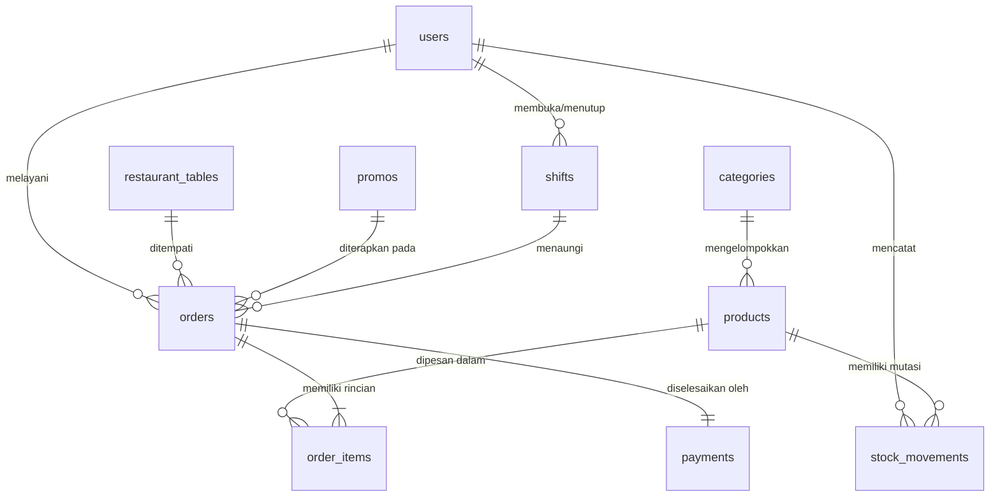

# Database Schema Documentation
## Sistem Point of Sales (POS) Coffee Shop

**Database Engine:** MySQL 8.x (Storage Engine: InnoDB, Charset: `utf8mb4`, Collation: `utf8mb4_unicode_ci`)  
**Dokumen Referensi:** [PRD.md](file:///home/djan/Desktop/web-coffee/PRD.md)  
**Versi Schema:** 1.0  
**Tanggal:** 27 Oktober 2026  

---

## 1. Daftar Tabel

Berikut adalah daftar 10 tabel utama yang dirancang untuk mendukung seluruh alur bisnis POS:

| No | Nama Tabel | Deskripsi Singkat | Soft Delete |
| :---: | :--- | :--- | :---: |
| 1 | `users` | Menyimpan data akun pengguna sistem (Owner dan Cashier). | Ya |
| 2 | `shifts` | Rekapitulasi shift kerja kasir, saldo kas awal (*starting float*), dan kas akhir. | Tidak |
| 3 | `categories` | Pengelompokan jenis produk/menu makanan dan minuman. | Ya |
| 4 | `products` | Katalog menu makanan/minuman, harga, foto, dan status inventori saat ini. | Ya |
| 5 | `stock_movements` | Catatan audit mutasi stok masuk, keluar, penjualan, dan penyesuaian (*adjustment*). | Tidak |
| 6 | `restaurant_tables` | Master data meja kedai, kapasitas kursi, dan status ketersediaan (*dine-in*). | Ya |
| 7 | `promos` | Konfigurasi voucher/promo potongan harga (persentase & nominal tetap). | Ya |
| 8 | `orders` | Master data transaksi pesanan (*dine-in/takeaway*), status tagihan, dan rincian harga. | Tidak |
| 9 | `order_items` | Rincian item menu yang dipesan dalam suatu pesanan (*snapshot* harga & kuantitas). | Tidak |
| 10 | `payments` | Pencatatan transaksi pembayaran (Tunai maupun Midtrans Snap) & rekonsiliasi gateway. | Tidak |

---

## 2. Definisi Struktur Kolom Tabel

### 2.1 Tabel `users`
Menyimpan kredensial dan hak akses pengguna aplikasi (Owner dan Kasir).

| nama_kolom | tipe_data | constraint | keterangan |
| :--- | :--- | :--- | :--- |
| `id` | VARCHAR(36) | PRIMARY KEY | UUID v4 unik pengguna |
| `name` | VARCHAR(100) | NOT NULL | Nama lengkap kasir/owner |
| `email` | VARCHAR(100) | NOT NULL, UNIQUE | Alamat email terdaftar untuk login |
| `password` | VARCHAR(255) | NOT NULL | Hash kata sandi terenkripsi (bcrypt) |
| `role` | ENUM('owner', 'cashier') | NOT NULL | Hak akses pengguna |
| `is_active` | BOOLEAN | NOT NULL, DEFAULT TRUE | Status keaktifan akun pengguna |
| `created_at` | TIMESTAMP | NOT NULL, DEFAULT CURRENT_TIMESTAMP | Waktu data dibuat |
| `updated_at` | TIMESTAMP | NOT NULL, DEFAULT CURRENT_TIMESTAMP ON UPDATE CURRENT_TIMESTAMP | Waktu data terakhir diperbarui |
| `deleted_at` | TIMESTAMP | NULL | Timestamp soft delete akun |

---

### 2.2 Tabel `shifts`
Mencatat periode sesi kerja kasir, perputaran uang fisik kasir, dan rekonsiliasi saldo kas laci.

| nama_kolom | tipe_data | constraint | keterangan |
| :--- | :--- | :--- | :--- |
| `id` | VARCHAR(36) | PRIMARY KEY | UUID v4 sesi shift |
| `user_id` | VARCHAR(36) | NOT NULL, FK to `users.id` | Kasir yang bertugas membuka shift |
| `start_time` | TIMESTAMP | NOT NULL, DEFAULT CURRENT_TIMESTAMP | Waktu shift dibuka (*open shift*) |
| `end_time` | TIMESTAMP | NULL | Waktu shift ditutup (*close shift*) |
| `starting_cash` | BIGINT | NOT NULL | Modal awal laci kasir (satuan sen) |
| `expected_ending_cash` | BIGINT | NULL | Perhitungan sistem: modal + total tunai masuk (satuan sen) |
| `actual_ending_cash` | BIGINT | NULL | Hitungan fisik uang tunai saat tutup shift (satuan sen) |
| `cash_difference` | BIGINT | NULL | Selisih kas fisik vs sistem (actual - expected, satuan sen) |
| `status` | ENUM('open', 'closed') | NOT NULL, DEFAULT 'open' | Status sesi shift kasir |
| `notes` | TEXT | NULL | Catatan khusus saat buka/tutup shift |
| `created_at` | TIMESTAMP | NOT NULL, DEFAULT CURRENT_TIMESTAMP | Waktu data dibuat |
| `updated_at` | TIMESTAMP | NOT NULL, DEFAULT CURRENT_TIMESTAMP ON UPDATE CURRENT_TIMESTAMP | Waktu data terakhir diperbarui |

---

### 2.3 Tabel `categories`
Menampung pengelompokan produk untuk navigasi kasir dan laporan bisnis.

| nama_kolom | tipe_data | constraint | keterangan |
| :--- | :--- | :--- | :--- |
| `id` | VARCHAR(36) | PRIMARY KEY | UUID v4 kategori |
| `name` | VARCHAR(100) | NOT NULL | Nama kategori (misal: "Espresso Based") |
| `slug` | VARCHAR(100) | NOT NULL, UNIQUE | Identifier ramah URL/kode unik kategori |
| `description` | VARCHAR(255) | NULL | Deskripsi singkat kategori |
| `sort_order` | INT | NOT NULL, DEFAULT 0 | Urutan prioritas penataan menu di kasir |
| `status` | ENUM('active', 'inactive') | NOT NULL, DEFAULT 'active' | Status keaktifan kategori |
| `created_at` | TIMESTAMP | NOT NULL, DEFAULT CURRENT_TIMESTAMP | Waktu data dibuat |
| `updated_at` | TIMESTAMP | NOT NULL, DEFAULT CURRENT_TIMESTAMP ON UPDATE CURRENT_TIMESTAMP | Waktu data terakhir diperbarui |
| `deleted_at` | TIMESTAMP | NULL | Timestamp soft delete kategori |

---

### 2.4 Tabel `products`
Katalog item makanan, minuman, dan merchandise yang dijual.

| nama_kolom | tipe_data | constraint | keterangan |
| :--- | :--- | :--- | :--- |
| `id` | VARCHAR(36) | PRIMARY KEY | UUID v4 produk |
| `category_id` | VARCHAR(36) | NOT NULL, FK to `categories.id` | Relasi ke kategori produk |
| `sku` | VARCHAR(50) | NOT NULL, UNIQUE | Kode unik stok/barcode produk |
| `name` | VARCHAR(150) | NOT NULL | Nama item menu |
| `description` | TEXT | NULL | Deskripsi komposisi / informasi menu |
| `price` | BIGINT | NOT NULL | Harga jual produk ke konsumen (satuan sen) |
| `cost_price` | BIGINT | NOT NULL, DEFAULT 0 | Harga pokok penjualan / HPP (satuan sen) |
| `image_url` | VARCHAR(255) | NULL | Path/URL berkas foto menu |
| `current_stock` | INT | NOT NULL, DEFAULT 0 | Jumlah stok fisik produk saat ini |
| `min_stock_alert` | INT | NOT NULL, DEFAULT 5 | Batas minimum peringatan stok menipis |
| `status` | ENUM('active', 'inactive') | NOT NULL, DEFAULT 'active' | Status ketersediaan menu di kasir |
| `created_at` | TIMESTAMP | NOT NULL, DEFAULT CURRENT_TIMESTAMP | Waktu data dibuat |
| `updated_at` | TIMESTAMP | NOT NULL, DEFAULT CURRENT_TIMESTAMP ON UPDATE CURRENT_TIMESTAMP | Waktu data terakhir diperbarui |
| `deleted_at` | TIMESTAMP | NULL | Timestamp soft delete produk |

---

### 2.5 Tabel `stock_movements`
Buku besar riwayat audit mutasi stok produk (tiap penambahan, penjualan, dan penyesuaian tercatat permanen).

| nama_kolom | tipe_data | constraint | keterangan |
| :--- | :--- | :--- | :--- |
| `id` | VARCHAR(36) | PRIMARY KEY | UUID v4 log mutasi stok |
| `product_id` | VARCHAR(36) | NOT NULL, FK to `products.id` | Relasi ke produk yang bermutasi |
| `user_id` | VARCHAR(36) | NOT NULL, FK to `users.id` | User yang melakukan/memverifikasi mutasi |
| `movement_type` | ENUM('IN', 'OUT', 'SALE', 'ADJUSTMENT') | NOT NULL | Jenis pergerakan stok |
| `quantity` | INT | NOT NULL | Jumlah perubahan stok (nilai mutlak positif) |
| `stock_before` | INT | NOT NULL | Jumlah stok sebelum perubahan dilakukan |
| `stock_after` | INT | NOT NULL | Jumlah stok setelah perubahan dilakukan |
| `reference_type` | ENUM('order', 'manual_adjustment', 'initial_stock', 'waste') | NOT NULL | Dokumen/sumber rujukan mutasi |
| `reference_id` | VARCHAR(36) | NULL | ID dokumen referensi (misal `orders.id`) |
| `notes` | VARCHAR(255) | NULL | Keterangan alasan penyesuaian |
| `created_at` | TIMESTAMP | NOT NULL, DEFAULT CURRENT_TIMESTAMP | Waktu mutasi terjadi |
| `updated_at` | TIMESTAMP | NOT NULL, DEFAULT CURRENT_TIMESTAMP ON UPDATE CURRENT_TIMESTAMP | Waktu data diperbarui |

---

### 2.6 Tabel `restaurant_tables`
Daftar meja kedai untuk kebutuhan operasional santap di tempat (*dine-in*).

| nama_kolom | tipe_data | constraint | keterangan |
| :--- | :--- | :--- | :--- |
| `id` | VARCHAR(36) | PRIMARY KEY | UUID v4 meja |
| `table_number` | VARCHAR(20) | NOT NULL, UNIQUE | Kode/nomor meja (misal: "M-01", "VIP-1") |
| `capacity` | INT | NOT NULL, DEFAULT 2 | Kapasitas jumlah kursi/orang |
| `status` | ENUM('available', 'occupied', 'reserved') | NOT NULL, DEFAULT 'available' | Status operasional meja |
| `created_at` | TIMESTAMP | NOT NULL, DEFAULT CURRENT_TIMESTAMP | Waktu data dibuat |
| `updated_at` | TIMESTAMP | NOT NULL, DEFAULT CURRENT_TIMESTAMP ON UPDATE CURRENT_TIMESTAMP | Waktu data terakhir diperbarui |
| `deleted_at` | TIMESTAMP | NULL | Timestamp soft delete meja |

---

### 2.7 Tabel `promos`
Konfigurasi voucher dan program diskon promosi.

| nama_kolom | tipe_data | constraint | keterangan |
| :--- | :--- | :--- | :--- |
| `id` | VARCHAR(36) | PRIMARY KEY | UUID v4 promo |
| `code` | VARCHAR(50) | NOT NULL, UNIQUE | Kode unik kupon/voucher (misal: "DISKONKOPI") |
| `name` | VARCHAR(100) | NOT NULL | Nama program promo |
| `discount_type` | ENUM('percentage', 'fixed_amount') | NOT NULL | Tipe pemotongan harga |
| `discount_value` | BIGINT | NOT NULL | Nilai diskon: jika persentase (1-100), jika nominal (satuan sen) |
| `max_discount` | BIGINT | NULL | Maksimal diskon untuk tipe persentase (satuan sen) |
| `min_spend` | BIGINT | NOT NULL, DEFAULT 0 | Minimal total belanja subtotal (satuan sen) |
| `start_date` | TIMESTAMP | NOT NULL | Tanggal dan jam mulai berlaku promo |
| `end_date` | TIMESTAMP | NOT NULL | Tanggal dan jam batas akhir promo |
| `quota` | INT | NULL | Kuota maksimal penggunaan (NULL = tanpa batas) |
| `used_count` | INT | NOT NULL, DEFAULT 0 | Jumlah voucher yang telah berhasil ditebus |
| `status` | ENUM('active', 'inactive') | NOT NULL, DEFAULT 'active' | Saklar aktifasi promo oleh Owner |
| `created_at` | TIMESTAMP | NOT NULL, DEFAULT CURRENT_TIMESTAMP | Waktu data dibuat |
| `updated_at` | TIMESTAMP | NOT NULL, DEFAULT CURRENT_TIMESTAMP ON UPDATE CURRENT_TIMESTAMP | Waktu data terakhir diperbarui |
| `deleted_at` | TIMESTAMP | NULL | Timestamp soft delete promo |

---

### 2.8 Tabel `orders`
Master data setiap transaksi pesanan pelanggan kedai kopi.

| nama_kolom | tipe_data | constraint | keterangan |
| :--- | :--- | :--- | :--- |
| `id` | VARCHAR(36) | PRIMARY KEY | UUID v4 transaksi order |
| `invoice_number` | VARCHAR(50) | NOT NULL, UNIQUE | Nomor invoice formal (contoh: "INV-20261027-0001") |
| `shift_id` | VARCHAR(36) | NOT NULL, FK to `shifts.id` | Relasi ke sesi shift kasir saat order dibuat |
| `cashier_id` | VARCHAR(36) | NOT NULL, FK to `users.id` | Kasir pembuat pesanan |
| `table_id` | VARCHAR(36) | NULL, FK to `restaurant_tables.id` | Meja dipilih (Wajib jika dine-in, NULL jika takeaway) |
| `order_type` | ENUM('dine_in', 'takeaway') | NOT NULL | Jenis pesanan pelanggan |
| `promo_id` | VARCHAR(36) | NULL, FK to `promos.id` | Relasi voucher diskon yang digunakan (maks 1 promo) |
| `subtotal` | BIGINT | NOT NULL | Total harga produk kotor (satuan sen) |
| `discount_amount` | BIGINT | NOT NULL, DEFAULT 0 | Nominal potongan promo (satuan sen) |
| `tax_amount` | BIGINT | NOT NULL, DEFAULT 0 | Nominal pajak PB1/PPN (satuan sen) |
| `total_amount` | BIGINT | NOT NULL | Total akhir tagihan wajib bayar (satuan sen) |
| `payment_method` | ENUM('cash', 'midtrans_snap') | NOT NULL | Metode pembayaran yang dipilih saat checkout |
| `status` | ENUM('pending', 'paid', 'cancelled', 'expired') | NOT NULL, DEFAULT 'pending' | Status penyelesaian tagihan pesanan |
| `customer_notes` | VARCHAR(255) | NULL | Catatan pesanan global dari pembeli |
| `created_at` | TIMESTAMP | NOT NULL, DEFAULT CURRENT_TIMESTAMP | Waktu order dibuat |
| `updated_at` | TIMESTAMP | NOT NULL, DEFAULT CURRENT_TIMESTAMP ON UPDATE CURRENT_TIMESTAMP | Waktu data terakhir diperbarui |

---

### 2.9 Tabel `order_items`
Rincian item produk yang dipesan dalam satu order (*snapshot* nilai harga saat transaksi terjadi).

| nama_kolom | tipe_data | constraint | keterangan |
| :--- | :--- | :--- | :--- |
| `id` | VARCHAR(36) | PRIMARY KEY | UUID v4 item rincian order |
| `order_id` | VARCHAR(36) | NOT NULL, FK to `orders.id` | Relasi ke invoice order induk |
| `product_id` | VARCHAR(36) | NOT NULL, FK to `products.id` | Relasi ke master produk |
| `product_name` | VARCHAR(150) | NOT NULL | *Snapshot* nama menu saat pesanan dibuat |
| `price` | BIGINT | NOT NULL | *Snapshot* harga satuan jual produk (satuan sen) |
| `cost_price` | BIGINT | NOT NULL, DEFAULT 0 | *Snapshot* HPP produk untuk audit profit (satuan sen) |
| `quantity` | INT | NOT NULL | Kuantitas jumlah yang dipesan ($\ge 1$) |
| `subtotal` | BIGINT | NOT NULL | Kalkulasi: `price * quantity` (satuan sen) |
| `notes` | VARCHAR(255) | NULL | Catatan custom item (misal: "Less sugar, oatmilk") |
| `created_at` | TIMESTAMP | NOT NULL, DEFAULT CURRENT_TIMESTAMP | Waktu item ditambahkan |
| `updated_at` | TIMESTAMP | NOT NULL, DEFAULT CURRENT_TIMESTAMP ON UPDATE CURRENT_TIMESTAMP | Waktu data terakhir diperbarui |

---

### 2.10 Tabel `payments`
Mendokumentasikan alur pembayaran tunai maupun integrasi gateway Midtrans Snap secara presisi dan idempotent.

| nama_kolom | tipe_data | constraint | keterangan |
| :--- | :--- | :--- | :--- |
| `id` | VARCHAR(36) | PRIMARY KEY | UUID v4 pencatatan pembayaran |
| `order_id` | VARCHAR(36) | NOT NULL, UNIQUE, FK to `orders.id` | Relasi satu pembayaran untuk satu pesanan |
| `payment_method` | ENUM('cash', 'midtrans_snap') | NOT NULL | Metode pembayaran yang dieksekusi |
| `amount` | BIGINT | NOT NULL | Nominal tagihan yang harus dibayar (satuan sen) |
| `cash_received` | BIGINT | NULL | Uang fisik diterima dari pembeli (pembayaran tunai, satuan sen) |
| `cash_change` | BIGINT | NULL | Uang kembalian yang diberikan (pembayaran tunai, satuan sen) |
| `snap_token` | VARCHAR(255) | NULL | Token transaksi Snap yang di-generate Midtrans |
| `snap_redirect_url` | VARCHAR(255) | NULL | URL pengalihan pembayaran dari Midtrans Snap |
| `midtrans_order_id` | VARCHAR(100) | NULL, UNIQUE | Identifier order unik yang dikirimkan ke Midtrans |
| `midtrans_transaction_id`| VARCHAR(100) | NULL | ID referensi transaksi internal Midtrans |
| `payment_type` | VARCHAR(50) | NULL | Saluran bayar spesifik (misal: `qris`, `gopay`, `bank_transfer`) |
| `status` | ENUM('pending', 'settlement', 'capture', 'deny', 'cancel', 'expire') | NOT NULL, DEFAULT 'pending' | Status verifikasi pembayaran |
| `settlement_time` | TIMESTAMP | NULL | Waktu uang lunas diterima (dari webhook/kasir) |
| `raw_response` | JSON | NULL | Arsip payload JSON webhook Midtrans untuk audit trail |
| `created_at` | TIMESTAMP | NOT NULL, DEFAULT CURRENT_TIMESTAMP | Waktu entri pembayaran dibuka |
| `updated_at` | TIMESTAMP | NOT NULL, DEFAULT CURRENT_TIMESTAMP ON UPDATE CURRENT_TIMESTAMP | Waktu data diperbarui |

---

## 3. Relasi Antar Tabel (Foreign Keys)

Berikut adalah pemetaan seluruh relasi foreign key dalam sistem:

### 3.1 Daftar Foreign Key Relationships

| Relasi Foreign Key | Keterangan |
| :--- | :--- |
| `[shifts.user_id] → [users.id]` | Kasir yang bertugas membuka dan bertanggung jawab atas sesi shift kas |
| `[products.category_id] → [categories.id]` | Kategori tempat produk makanan/minuman dikelompokkan |
| `[stock_movements.product_id] → [products.id]` | Produk yang mengalami perubahan kuantitas stok |
| `[stock_movements.user_id] → [users.id]` | Pengguna (Owner/Cashier) yang memicu atau mencatat mutasi stok |
| `[orders.shift_id] → [shifts.id]` | Sesi shift kerja aktif tempat transaksi pesanan dibuat dan dicatat |
| `[orders.cashier_id] → [users.id]` | Kasir yang melayani pembuatan pesanan pelanggan |
| `[orders.table_id] → [restaurant_tables.id]` | Meja yang ditempati untuk pesanan tipe dine-in (NULL jika takeaway) |
| `[orders.promo_id] → [promos.id]` | Program diskon/promo yang diaplikasikan ke pesanan (maks 1 promo, NULL jika tanpa promo) |
| `[order_items.order_id] → [orders.id]` | Transaksi order induk yang menaungi rincian item pesanan |
| `[order_items.product_id] → [products.id]` | Produk menu yang dibeli dalam rincian pesanan |
| `[payments.order_id] → [orders.id]` | Transaksi pesanan yang dilunasi oleh rekaman pembayaran (relasi 1-ke-1) |

Format ringkas:
- `[shifts.user_id] → [users.id]` | Kasir yang bertugas membuka dan bertanggung jawab atas sesi shift kas
- `[products.category_id] → [categories.id]` | Kategori tempat produk makanan/minuman dikelompokkan
- `[stock_movements.product_id] → [products.id]` | Produk yang mengalami perubahan kuantitas stok
- `[stock_movements.user_id] → [users.id]` | Pengguna (Owner/Cashier) yang memicu atau mencatat mutasi stok
- `[orders.shift_id] → [shifts.id]` | Sesi shift kerja aktif tempat transaksi pesanan dibuat dan dicatat
- `[orders.cashier_id] → [users.id]` | Kasir yang melayani pembuatan pesanan pelanggan
- `[orders.table_id] → [restaurant_tables.id]` | Meja yang ditempati untuk pesanan tipe dine-in (NULL jika takeaway)
- `[orders.promo_id] → [promos.id]` | Program diskon/promo yang diaplikasikan ke pesanan (maks 1 promo, NULL jika tanpa promo)
- `[order_items.order_id] → [orders.id]` | Transaksi order induk yang menaungi rincian item pesanan
- `[order_items.product_id] → [products.id]` | Produk menu yang dibeli dalam rincian pesanan
- `[payments.order_id] → [orders.id]` | Transaksi pesanan yang dilunasi oleh rekaman pembayaran (relasi 1-ke-1)

---

### 3.2 Diagram ERD

### 3.3 Rincian Aturan Foreign Key Constraints:

1. **`[shifts.user_id] → [users.id]`**
   - *Constraint:* `ON DELETE RESTRICT ON UPDATE CASCADE`
   - *Penjelasan:* Akun kasir yang memiliki riwayat shift tidak boleh dihapus fisik dari database.
2. **`[products.category_id] → [categories.id]`**
   - *Constraint:* `ON DELETE RESTRICT ON UPDATE CASCADE`
   - *Penjelasan:* Kategori tidak dapat dihapus jika masih ada produk aktif yang terkait.
3. **`[stock_movements.product_id] → [products.id]`**
   - *Constraint:* `ON DELETE RESTRICT ON UPDATE CASCADE`
   - *Penjelasan:* Menjamin histori perubahan stok tidak kehilangan referensi produk.
4. **`[stock_movements.user_id] → [users.id]`**
   - *Constraint:* `ON DELETE RESTRICT ON UPDATE CASCADE`
   - *Penjelasan:* Menjamin data penanggung jawab mutasi stok tercatat permanen.
5. **`[orders.shift_id] → [shifts.id]`**
   - *Constraint:* `ON DELETE RESTRICT ON UPDATE CASCADE`
   - *Penjelasan:* Setiap order wajib terikat ke shift kerja kasir yang valid.
6. **`[orders.cashier_id] → [users.id]`**
   - *Constraint:* `ON DELETE RESTRICT ON UPDATE CASCADE`
   - *Penjelasan:* Mencegah hilangnya jejak kasir yang melayani transaksi.
7. **`[orders.table_id] → [restaurant_tables.id]`**
   - *Constraint:* `ON DELETE SET NULL ON UPDATE CASCADE`
   - *Penjelasan:* Meja bersifat opsional (NULL jika takeaway) dan jika meja dinonaktifkan tidak merusak invoice.
8. **`[orders.promo_id] → [promos.id]`**
   - *Constraint:* `ON DELETE RESTRICT ON UPDATE CASCADE`
   - *Penjelasan:* Promo yang telah digunakan dalam invoice order tidak boleh dihapus fisik.
9. **`[order_items.order_id] → [orders.id]`**
   - *Constraint:* `ON DELETE CASCADE ON UPDATE CASCADE`
   - *Penjelasan:* Rincian item selalu menjadi satu kesatuan hidup dengan order induknya.
10. **`[order_items.product_id] → [products.id]`**
    - *Constraint:* `ON DELETE RESTRICT ON UPDATE CASCADE`
    - *Penjelasan:* Mencegah penghapusan produk yang sudah pernah terjual.
11. **`[payments.order_id] → [orders.id]`**
    - *Constraint:* `ON DELETE RESTRICT ON UPDATE CASCADE`
    - *Penjelasan:* Relasi 1-ke-1 ketat antara satu pesanan dan satu proses pembayaran.

---

## 4. Keputusan Desain yang Penting

### 4.1 Pemilihan UUID (`VARCHAR(36)`) untuk Primary Key
- **Alasan & Manfaat:**
  - **Keamanan & Enumerasi:** `AUTO_INCREMENT` numerik sekuensial (misal ID 1, 2, 3...) memudahkan pihak luar menebak volume transaksi harian, total pelanggan, atau jumlah menu melalui URL / parameter API (*insecure direct object references*). UUID v4 menghasilkan string acak 128-bit yang tidak dapat ditebak.
  - **Distribusi & Skalabilitas Masa Depan:** Jika sistem diperluas ke arsitektur multi-node atau offline-first sync (kasir tetap bisa mengenerate ID secara lokal di browser/client saat offline sebelum di-push ke server), UUID menjamin tidak akan terjadi benturan kunci (*primary key collision*).
  - **Standar Integrasi Midtrans:** Midtrans Snap membutuhkan identifikasi order unik. UUID sangat mudah dipadukan menjadi `order_id` unik Midtrans tanpa risiko tumpang tindih.

### 4.2 Penggunaan `BIGINT` dalam Satuan Sen untuk Harga dan Uang
- **Alasan & Manfaat:**
  - **Menghindari Floating-Point Rounding Error:** Tipe data pecahan desimal biner seperti `FLOAT` atau `DOUBLE` memiliki kelemahan presisi IEEE 754 (misal: $0.1 + 0.2 = 0.30000000000000004$). Dalam kalkulasi keuangan kasir, ketidakakuratan ini dapat mengakibatkan selisih saldo pembukuan (*balance sheet mismatch*).
  - **Efisiensi & Integritas Satuan Sen:** Nilai mata uang Rupiah dikonversikan ke satuan terkecilnya yaitu **Sen** ($1\text{ Rupiah} = 100\text{ Sen}$).
    - Contoh: Harga menu Rp 25.000 disimpan sebagai `2500000`.
    - Contoh: Potongan diskon Rp 5.000 disimpan sebagai `500000`.
  - Operasi matematika integer pada `BIGINT` di Go dan MySQL jauh lebih cepat, deterministik, dan bebas dari distorsi pembulatan bila dibandingkan dengan tipe numerik aproksimasi.

### 4.3 Snapshot Data pada Tabel `order_items`
- **Alasan:** Nama produk (`product_name`), harga jual (`price`), dan HPP (`cost_price`) sengaja diduplikasi sebagai *snapshot* ke dalam tabel `order_items`.
- **Manfaat:** Ketika di masa depan Owner menaikkan harga "Kopi Latte" dari Rp 28.000 menjadi Rp 32.000, atau mengubah nama menunya, data historis laporan penjualan lama tidak ikut berubah. Pembukuan bulan lalu tetap akurat mencatat harga saat transaksi itu dibuat.

### 4.4 Soft Delete (`deleted_at`) pada Entitas Master
- **Alasan:** Sesuai Business Rule PRD, entitas seperti `users`, `products`, `categories`, `restaurant_tables`, dan `promos` tidak boleh dihapus permanen (*hard delete*) jika pernah terlibat dalam transaksi.
- **Implementasi:** Kolom `deleted_at` (TIMESTAMP, default `NULL`) diterapkan. Ketika di-delete, sistem mengisi timestamp waktu penghapusan. Query aktif kasir cukup memfilter `WHERE deleted_at IS NULL`. Integritas referensial laporan dan audit finansial masa lalu tetap 100% terjaga.

### 4.5 Penggunaan Tipe Data `ENUM` untuk Kolom Status Terbatas
- **Alasan:** Status operasional seperti status shift (`open`, `closed`), status meja (`available`, `occupied`, `reserved`), status pesanan (`pending`, `paid`, `cancelled`, `expired`), dan role (`owner`, `cashier`) memiliki jumlah nilai yang terbatas, pasti, dan tidak bertambah secara dinamis setiap hari.
- **Manfaat:**
  - **Integritas Tingkat Database:** MySQL secara otomatis menolak (*reject*) string apa pun di luar nilai ENUM yang sah.
  - **Efisiensi Penyimpanan:** MySQL menyimpan ENUM secara internal sebagai indeks integer 1 atau 2 byte, bukan string panjang, menghemat penggunaan ruang *buffer pool* dan mempercepat *indexing*.

### 4.6 Pemisahan Tabel `orders` dan `payments`
- **Alasan:** Memisahkan entitas *invoice belanja* dari *bukti dan interaksi pembayaran*.
- **Manfaat:**
  - Menyimpan token Snap, respon payload mentah JSON dari Midtrans, serta catatan detail uang tunai kasir (`cash_received` dan `cash_change`) secara rapi tanpa mengotori tabel utama `orders`.
  - Memberikan titik validasi yang bersih untuk menjamin pemrosesan webhook Midtrans bersifat **Idempotent** (mencegah pemotongan stok ganda jika notifikasi webhook Midtrans diulang).
